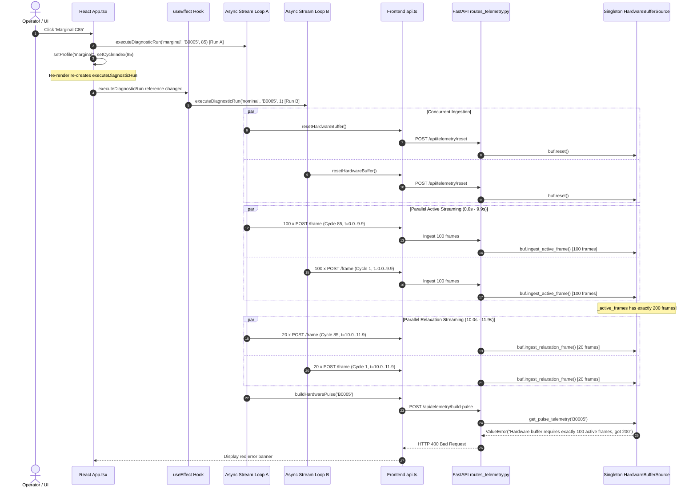

# ThermoCell-AI Hardware Frame Pipeline Investigation Report
## Issue B: Hardware Buffer Active Frame Count Overflow (Expected 100, Got 200)

**Author:** Hardware Frame Pipeline Investigator  
**Date:** 2026-11-09  
**Status:** Diagnosed  
**Target Artifact:** `.gsd/investigations/ISSUE_B_HARDWARE_FRAME.md`  

---

## 1. Executive Summary

During physical ESP32 hardware streaming mode, the diagnostic pipeline fails at the pulse-build stage with HTTP 400 Bad Request:
```
Hardware buffer requires exactly 100 active frames, got 200
```

### Protocol Specification
- **Active Phase:** Exactly 100 active frames sampled at 10 Hz ($t \in [0.0, 9.9]\,\text{s}$).
- **Relaxation Phase:** Exactly 20 relaxation frames sampled at 10 Hz ($t \in [10.0, 11.9]\,\text{s}$).
- **Total Diagnostic Run:** Exactly 120 frames per run ($10.0\,\text{s}$ active discharge pulse $+ 2.0\,\text{s}$ recovery).
- **Pulse-Build Requests:** Exactly one `/api/telemetry/build-pulse` request per completed diagnostic run.

### Root Cause Summary
The failure is caused by an **uncontrolled dual-execution reactive loop in `frontend/src/App.tsx`**. An initial mount/auth `useEffect` hook (`App.tsx:289-293`) was configured with the unstable callback `executeDiagnosticRun` in its dependency array. Whenever a user interacts with the UI (such as clicking the **Marginal C85** profile button in the video recording):
1. The UI handler (`App.tsx:305-311`) immediately triggers **Run 1** (`executeDiagnosticRun`) and mutates state (`setProfile`, `setCycleIndex`).
2. React re-renders `<App />`, generating a new instance of `executeDiagnosticRun` via `useCallback` (`App.tsx:276-286`).
3. The reactive `useEffect` detects the dependency change and immediately triggers **Run 2** (`executeDiagnosticRun('nominal', 'B0005', 1)`).
4. `executeHardwareRun` (`App.tsx:167-273`) lacks an execution mutex, cancellation token, or in-loop request ID check. Both Run 1 and Run 2 execute their 120-step `for` loops concurrently across the network.
5. Both runs stream 100 active frames into the backend's shared global in-memory singleton `_hardware_buffer` (`routes_telemetry.py:18`).
6. Active frames accumulate to exactly **$100 + 100 = 200$** frames. When either run calls `/api/telemetry/build-pulse`, backend validation fails at `telemetry_source.py:175-176`.

---

## 2. Empirical Video Evidence Analysis (`issue.mp4`)

Video inspection was conducted using `ffprobe` and `ffmpeg` frame extraction on `C:\Users\Asus\OneDrive\Desktop\Thermocell-ai\issue.mp4` (Duration: 18.18s, 30fps):

| Video Timestamp | Visual State | Pipeline Event |
|:---|:---|:---|
| **00:00.0 - 00:01.2** | Top banner: `Streaming physical DAQ telemetry: 74 / 120 frames ingested...` progressing to `103 / 120` (86%). Header button: `SAMPLING (10S)...`. | An initial hardware streaming run was already in progress when the recording started (spawned either during component mount via React 18 `StrictMode` or mode toggle). |
| **00:01.5** | Progress banner disappears. Red banner appears: `Hardware pulse build failed: 400 {"detail":"Hardware buffer requires exactly 100 active frames, got 200"}`. Header button reverts to `RUN 10S DIAGNOSTIC`. | Pulse-build failed at line 176 of `telemetry_source.py` because 2 concurrent loops flooded the singleton buffer with 200 active frames. |
| **00:04.0** | User moves mouse and clicks `DISMISS` on the red error banner. | Error banner is cleared from UI state. |
| **00:05.5** | User moves cursor to the top header profile preset bar and clicks **Marginal C85**. | `handleSelectProfile('marginal')` is invoked. It calls `setProfile('marginal')`, `setCycleIndex(85)`, and synchronously starts `executeDiagnosticRun` (Run A). |
| **00:06.0** | Top banner immediately reactivates: `Streaming physical DAQ telemetry: 9 / 120 frames ingested into hardware buffer... 8%`. | React re-renders `<App />`. The re-render re-creates `executeDiagnosticRun`, which causes `useEffect` (`App.tsx:289`) to fire Run B. Both Run A and Run B are now streaming. |
| **00:07.5** | Counter rapidly increments: `67 / 120` (56%), then `105 / 120` (88%). | UI updates reflect the streaming progress of the parallel loops. |
| **00:08.5** | Counter reaches 120/120. Ingestion completes. Immediately, the red error banner re-appears: `Hardware pulse build failed: 400 {"detail":"Hardware buffer requires exactly 100 active frames, got 200"}`. | Run A (or Run B) calls `/api/telemetry/build-pulse`. Backend rejects the 200 buffered active frames with HTTP 400. |

---

## 3. Comprehensive 9-Stage Frame Pipeline Trace



### Stage 1: Frontend Hardware-Run Trigger
Diagnostic runs are initiated from 8 locations in `frontend/src/App.tsx`:
1. `App.tsx:305-311`: `handleSelectProfile` (preset buttons: Healthy C1, Marginal C85, Degraded C160).
2. `App.tsx:296-302`: `handleSelectCell` (cell selection dropdown).
3. `App.tsx:314-317`: `handleSelectCycle` (cycle selection dropdown).
4. `App.tsx:337-340`: `handleToggleHardwareMode` (switching simulation to hardware).
5. `App.tsx:368`: Primary CTA button (`RUN 10S DIAGNOSTIC` in `TopHeader.tsx:165`).
6. `App.tsx:409`: CTA button in `DashboardView.tsx:1418`.
7. `App.tsx:420`: CTA button in `LiveMonitoringView.tsx:161`.
8. `App.tsx:289-293`: Reactive mount hook `useEffect(..., [executeDiagnosticRun])`.

### Stage 2: Event Handlers and Component Lifecycle
When the user clicks a profile preset (e.g., Marginal C85), `handleSelectProfile` executes:
```tsx
const handleSelectProfile = (newProfile: 'nominal' | 'marginal' | 'degraded') => {
  setProfile(newProfile);
  const bench = BENCHMARK_CELL_DATA[cellId];
  const targetCycle = bench ? (newProfile === 'nominal' ? bench.nominalCycle : newProfile === 'marginal' ? bench.marginalCycle : bench.degradedCycle) : null;
  setCycleIndex(targetCycle);
  executeDiagnosticRun(newProfile, cellId, targetCycle); // <--- Run A starts
};
```
Simultaneously:
- `setProfile` and `setCycleIndex` schedule a React re-render.
- On re-render, `executeHardwareRun` is recreated because its dependencies `[cellId, profile, cycleIndex]` changed (`App.tsx:273`).
- Consequently, `executeDiagnosticRun` is recreated because its dependencies `[isHardwareMode, profile, cellId, cycleIndex, executeSimulationRun, executeHardwareRun]` changed (`App.tsx:286`).
- The `useEffect` hook:
  ```tsx
  // Attempt initial baseline simulation if logged in
  useEffect(() => {
    if (isAuthenticated()) {
      executeDiagnosticRun('nominal', 'B0005', 1); // <--- Run B starts!
    }
  }, [executeDiagnosticRun]);
  ```
  notices `executeDiagnosticRun` has a new identity and executes immediately!

### Stage 3: Async Execution and Streaming Loops
In `executeHardwareRun` (`App.tsx:167-273`):
- Crucial defects in async execution:
  1. **No Loop Cancellation:** `activeRequestIdRef` is incremented on line 171, but the `for` loops NEVER check `if (currentRequestId !== activeRequestIdRef.current) break;`. When a second run starts, the first run continues sending all 120 frames.
  2. **No Concurrency Mutex:** There is no check `if (isLoading) return;` or `if (isStreamingRef.current) return;`.
  3. **No AbortController:** Requests are dispatched with unabortable standard `fetch` promises.

### Stage 4: Frame Generation or Physical Ingestion
- In the frontend simulation loop:
  - Active frames: 100 frames with $t = i \times 0.1 \in [0.0, 9.9]\,\text{s}$ (`App.tsx:203`).
  - Relaxation frames: 20 frames with $t = 10.0 + i \times 0.1 \in [10.0, 11.9]\,\text{s}$ (`App.tsx:229`).
- In physical/mock bridge (`hardware/serial_bridge.py:38-69`):
  - 100 active frames ($t \in [0.0, 9.9]\,\text{s}$) + 20 relaxation frames ($t \in [10.0, 11.9]\,\text{s}$).

### Stage 5: Active / Relaxation Classification
In backend `routes_telemetry.py:57-60`:
```python
if frame.timestamp < 10.0:
    buf.ingest_active_frame(frame)
else:
    buf.ingest_relaxation_frame(frame)
```
Classification logic is mathematically sound:
- Frames with $t \in [0.0, 9.9]$ satisfy $t < 10.0$ and are routed to active ingestion.
- Frames with $t \in [10.0, 11.9]$ satisfy $t \ge 10.0$ and are routed to relaxation ingestion.
Relaxation frames are NOT misclassified as active frames.

### Stage 6: API Submission
In `frontend/src/services/api.ts:210-228`:
- `ingestHardwareFrame` dispatches `POST /api/telemetry/frame`.
- Because two async loops run concurrently, 200 HTTP POST requests carrying active frames hit the endpoint.

### Stage 7: Backend Telemetry Ingestion
In `backend/app/api/routes_telemetry.py:50-68`:
- Ingestion lacks buffer capacity bounds checking (it unconditionally accepts frames even when `len(buf._active_frames) >= 100`).
- Ingestion lacks session locking or run identity matching.

### Stage 8: Buffer Storage and Isolation
In `backend/app/services/telemetry_source.py:125-161`:
- `_hardware_buffer = HardwareBufferSource()` is a process-wide singleton.
- `_active_frames` is an unbounded Python list protected by a threading lock:
- Two concurrent streams append their 100 active frames into the same list:
  $$\text{Total Active Frames} = 100 + 100 = 200$$
- In `HardwareBufferSource.get_pulse_telemetry`, `self.reset()` is ONLY called at line 248 after validation succeeds. When validation fails, the buffer remains uncleared.

### Stage 9: Pulse-Build Execution and Constraint Validation
In `backend/app/services/telemetry_source.py:175-176`:
```python
if len(self._active_frames) != 100:
    raise ValueError(f"Hardware buffer requires exactly 100 active frames, got {len(self._active_frames)}")
```
- The backend checks `len(self._active_frames) != 100`.
- Because 200 frames are present, it raises `ValueError("Hardware buffer requires exactly 100 active frames, got 200")`.
- `routes_telemetry.py:97-98` converts this to `HTTP 400 Bad Request`.
- In the frontend, the second run catches the error and displays it in the red alert banner.

---

## 4. Key Contrast: Why Simulation Mode Succeeded but Hardware Mode Failed

In **Simulation Mode** (`isHardwareMode === false`):
- Both Run 1 and Run 2 call `POST /api/simulate`.
- `POST /api/simulate` is completely stateless; it synthesizes telemetry dynamically using 1-RC ECM and thermodynamic diffusion without mutating backend server state.
- Both parallel requests succeed. `activeRequestIdRef.current` simply latches whichever request finishes second. The dual-trigger bug was completely silent.

In **Hardware Mode** (`isHardwareMode === true`):
- Both Run 1 and Run 2 stream frames into the shared global singleton `_hardware_buffer`.
- The two streams interleave their writes, injecting 200 active frames into the single stateful buffer.
- The stateful constraint check `len(self._active_frames) == 100` immediately tripped and exposed the dual-trigger bug.

---

## 5. Secondary Bug Identified: Benchmark DCIR vs Cycle Index Typo

In `frontend/src/App.tsx:190`:
```tsx
const dcir = profile === 'nominal' ? bench.nominalDcir : profile === 'marginal' ? bench.marginalCycle : bench.degradedCycle;
```
When `profile === 'marginal'`, `dcir` is assigned `bench.marginalCycle` ($85.0\,\Omega$) instead of `bench.marginalDcir` ($0.145\,\Omega$), and when `profile === 'degraded'`, it is assigned `bench.degradedCycle` ($160.0\,\Omega$) instead of `bench.degradedDcir` ($0.220\,\Omega$). While this did not cause the 200 frame count error, it produces unphysical terminal voltages during hardware streaming.

---

## 6. Minimal Proposed Fix

### Fix 1: Break the Dual-Execution Loop in `frontend/src/App.tsx`
1. Decouple initial mounting baseline execution from `executeDiagnosticRun` reference updates. Use an initialization ref `hasInitializedRef = useRef(false)` so that the effect runs strictly once on mount / login, and remove `executeDiagnosticRun` from its dependency array:
   ```tsx
   const hasInitializedRef = useRef(false);

   useEffect(() => {
     if (isAuthenticated() && !hasInitializedRef.current) {
       hasInitializedRef.current = true;
       executeDiagnosticRun('nominal', 'B0005', 1);
     }
   }, [isLoggedIn]);
   ```
2. Add an active execution guard at the top of `executeHardwareRun`:
   ```tsx
   const isStreamingRef = useRef(false);

   const executeHardwareRun = useCallback(async (selectedCell = cellId, selectedCycle = cycleIndex) => {
     if (isStreamingRef.current) {
       console.warn('Hardware streaming run already in progress; ignoring duplicate trigger.');
       return;
     }
     isStreamingRef.current = true;
     const currentRequestId = ++activeRequestIdRef.current;
     setIsLoading(true);
     setErrorMsg(null);
     try {
       // ...
       for (let i = 0; i < 100; i++) {
         if (currentRequestId !== activeRequestIdRef.current) return;
         await ingestHardwareFrame(frame);
         setHardwareFrameCount(i + 1);
       }
       for (let i = 0; i < 20; i++) {
         if (currentRequestId !== activeRequestIdRef.current) return;
         await ingestHardwareFrame(frame);
         setHardwareFrameCount(100 + i + 1);
       }
       // ...
     } finally {
       if (currentRequestId === activeRequestIdRef.current) {
         setIsLoading(false);
         setHardwareStreamActive(false);
         isStreamingRef.current = false;
       }
     }
   }, [cellId, profile, cycleIndex]);
   ```
3. Correct the DCIR benchmark assignment at line 190:
   ```tsx
   const dcir = profile === 'nominal' ? bench.nominalDcir : profile === 'marginal' ? bench.marginalDcir : bench.degradedDcir;
   ```

### Fix 2: Defense-in-Depth in Backend Ingestion (`telemetry_source.py` & `routes_telemetry.py`)
1. In `HardwareBufferSource.ingest_active_frame`:
   Enforce capacity limit:
   ```python
   def ingest_active_frame(self, frame: TelemetryFrame) -> None:
       with self._lock:
           if len(self._active_frames) >= 100:
               raise ValueError("Hardware buffer active frames at capacity (100). Clear buffer before starting a new run.")
           self._active_frames.append(frame)
   ```
2. In `HardwareBufferSource.ingest_relaxation_frame`:
   Enforce capacity limit:
   ```python
   def ingest_relaxation_frame(self, frame: TelemetryFrame) -> None:
       with self._lock:
           if len(self._relax_frames) >= 20:
               raise ValueError("Hardware buffer relaxation frames at capacity (20). Clear buffer before starting a new run.")
           self._relax_frames.append(frame)
   ```

---

## 7. Regression Test Requirements

1. **Frontend Concurrent Ingestion Prevention Test:**
   - Verify that `ingestHardwareFrame` is called exactly 120 times (100 active + 20 relaxation), never 240 or 200 times.
   - Verify that `buildHardwarePulse` is called exactly once.
2. **Frontend Fast-Switch Stream Cancellation Test:**
   - Rapidly switch cells or profiles; verify previous streaming loop aborts cleanly.
3. **Backend Buffer Overflow Rejection Test:**
   - Verify that `ValueError` is raised immediately upon the 101st active frame.

---

## 8. Exact Files to Modify

1. `frontend/src/App.tsx`
2. `backend/app/services/telemetry_source.py`
3. `backend/app/api/routes_telemetry.py`
4. `backend/tests/test_telemetry_source.py`
